# Informe de Desarrollo — Práctica 2

## Redes de Computadoras 1
### Segundo Semestre 2026

**Universidad de San Carlos de Guatemala**  
**Facultad de Ingeniería**  
**Escuela de Ingeniería en Ciencias y Sistemas**  
**Carné: 202113318**

---

# 1. Introducción

La Práctica 2 consistió en diseñar e implementar una infraestructura de red para cinco zonas representativas de Ciudad Cayalá utilizando Cisco Packet Tracer.

El desarrollo incluyó segmentación mediante VLANs, configuración de VTP, enlaces Trunk 802.1Q, Rapid PVST+, EtherChannel mediante LACP, redundancia física, enrutamiento inter-VLAN, direccionamiento IPv4 y pruebas de conectividad.

Además de comprobar el funcionamiento general de la topología, se realizaron pruebas de alta disponibilidad y análisis de protocolos utilizando el modo Simulation de Packet Tracer.

La implementación final permite comunicación entre las cinco zonas y mantiene mecanismos de redundancia para las áreas consideradas críticas.

---

# 2. Planificación inicial

Antes de comenzar la configuración de los dispositivos se definieron cinco zonas representativas:

| Zona | Área | VLAN | Hosts requeridos |
|---|---|---:|---:|
| Zona 1 | Paseo Cayalá | 18 | 60 |
| Zona 2 | Cayibel | 28 | 28 |
| Zona 3 | Cardales de Cayalá | 38 | 12 |
| Zona 4 | Plaza Cayalá | 48 | 50 |
| Zona 5 | Plaza Nogales | 58 | 7 |

También se definieron:

- VLAN 99 como VLAN nativa.
- VLAN 999 como VLAN Blackhole.
- Un switch principal y un switch de acceso por zona.
- Dos dispositivos finales representativos por zona.
- Un switch multicapa `CORE-L3` como dispositivo central de distribución y enrutamiento.

La topología fue diseñada de forma híbrida.

La estructura general utiliza una estrella alrededor del `CORE-L3`, mientras que la Zona 4 incorpora enlaces redundantes formando una estructura triangular.

La Zona 1 fue seleccionada para implementar EtherChannel debido a su mayor cantidad de hosts y tráfico esperado.

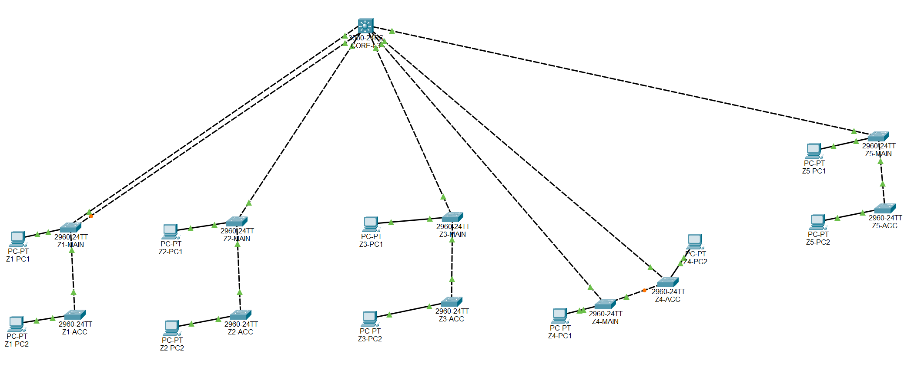

---

# 3. Diseño del direccionamiento IP

Se utilizó una subred independiente para cada zona.

El tamaño de cada subred fue seleccionado según la cantidad de hosts solicitados.

| Zona | VLAN | Red | Prefijo | Gateway |
|---|---:|---|---:|---|
| Zona 1 | 18 | 192.168.18.0 | /26 | 192.168.18.1 |
| Zona 2 | 28 | 192.168.28.0 | /27 | 192.168.28.1 |
| Zona 3 | 38 | 192.168.38.0 | /28 | 192.168.38.1 |
| Zona 4 | 48 | 192.168.48.0 | /26 | 192.168.48.1 |
| Zona 5 | 58 | 192.168.58.0 | /28 | 192.168.58.1 |

Las primeras direcciones utilizables fueron reservadas para las interfaces SVI del `CORE-L3`, funcionando como gateway de cada VLAN.

A los dispositivos finales se asignaron las siguientes direcciones:

```text
Z1-PC1  192.168.18.2
Z1-PC2  192.168.18.3

Z2-PC1  192.168.28.2
Z2-PC2  192.168.28.3

Z3-PC1  192.168.38.2
Z3-PC2  192.168.38.3

Z4-PC1  192.168.48.2
Z4-PC2  192.168.48.3

Z5-PC1  192.168.58.2
Z5-PC2  192.168.58.3
```

---

# 4. Creación de VLANs

Después de completar la topología física se procedió con la creación de las VLANs.

Se configuraron:

```text
VLAN 18   PASEO_CAYALA
VLAN 28   CAYIBEL
VLAN 38   CARDALES
VLAN 48   PLAZA_CAYALA
VLAN 58   PLAZA_NOGALES
VLAN 99   NATIVA
VLAN 999  BLACKHOLE
```

La VLAN 99 fue utilizada como VLAN nativa en los enlaces Trunk.

La VLAN 999 fue destinada exclusivamente a los puertos que no se utilizan.

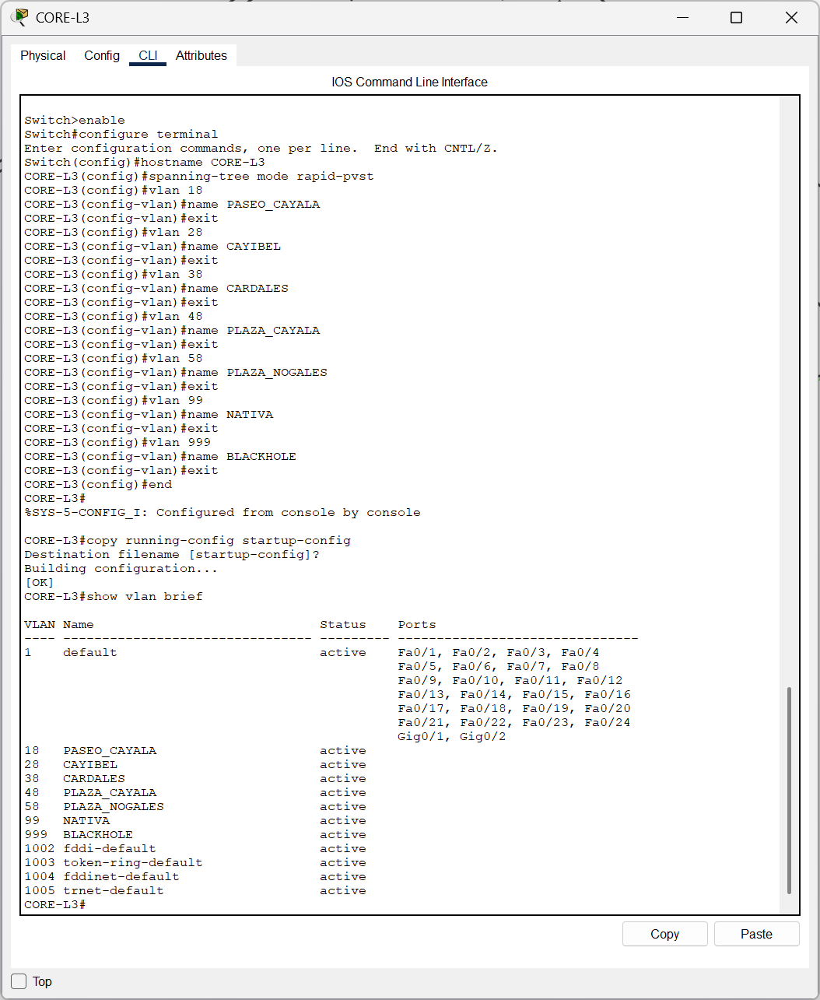

---

# 5. Implementación de VTP

Para la administración de VLANs se implementó VTP.

Se utilizaron los siguientes parámetros:

```text
Dominio: 202113318
Password: Cayala2026
```

Cada switch principal fue configurado como VTP Server y cada switch de acceso como VTP Client.

El `CORE-L3` se configuró en modo Transparent.

Ejemplo de la Zona 1:

```text
Z1-MAIN = VTP Server
Z1-ACC  = VTP Client
```

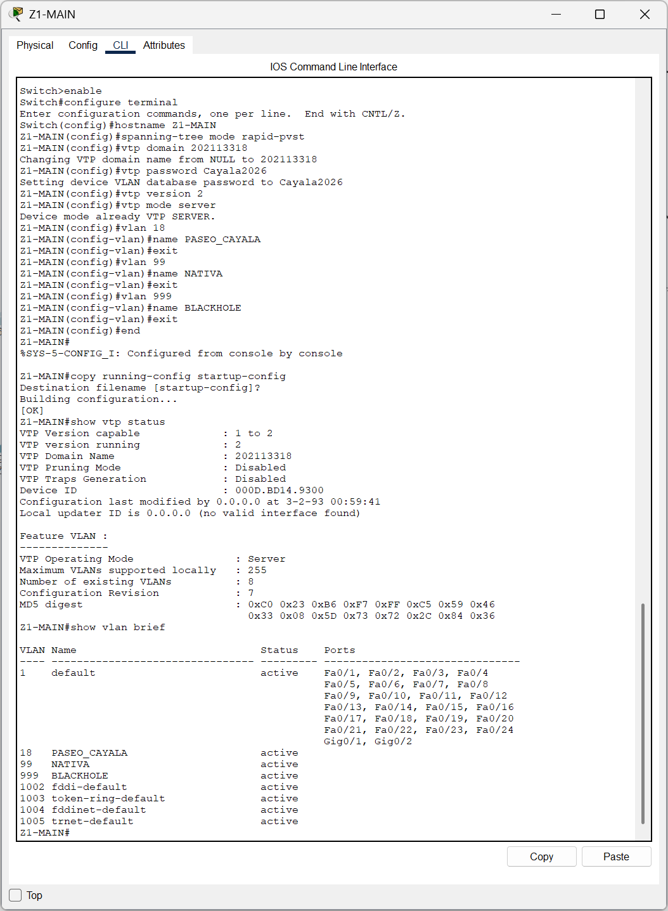

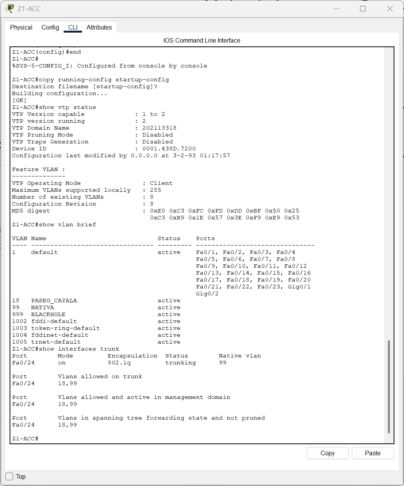

Durante el desarrollo se verificó la propagación de VLANs entre los switches antes de continuar con las configuraciones posteriores.

---

# 6. Configuración de puertos de acceso

Los puertos conectados a dispositivos finales fueron configurados explícitamente como puertos Access.

Cada PC fue asignada a la VLAN correspondiente a su zona.

Por ejemplo, en Zona 1:

```text
interface fa0/1
 switchport mode access
 switchport access vlan 18
 spanning-tree portfast
```

PortFast se utilizó únicamente en interfaces conectadas directamente a dispositivos finales.

Esto permite que dichos puertos lleguen rápidamente al estado Forwarding sin alterar el funcionamiento normal de Spanning Tree en los enlaces entre switches.

---

# 7. Configuración de enlaces Trunk

Los enlaces entre switches fueron configurados como Trunk utilizando IEEE 802.1Q.

La VLAN 99 fue utilizada como VLAN nativa.

También se restringieron las VLANs permitidas en cada enlace.

En el `CORE-L3` se configuró:

| Enlace | VLANs permitidas |
|---|---|
| Port-Channel1 | 18,99 |
| Fa0/3 | 28,99 |
| Fa0/4 | 38,99 |
| Fa0/5 | 48,99 |
| Fa0/6 | 48,99 |
| Fa0/7 | 58,99 |

Esta configuración evita transportar VLANs innecesarias por enlaces que no las requieren.

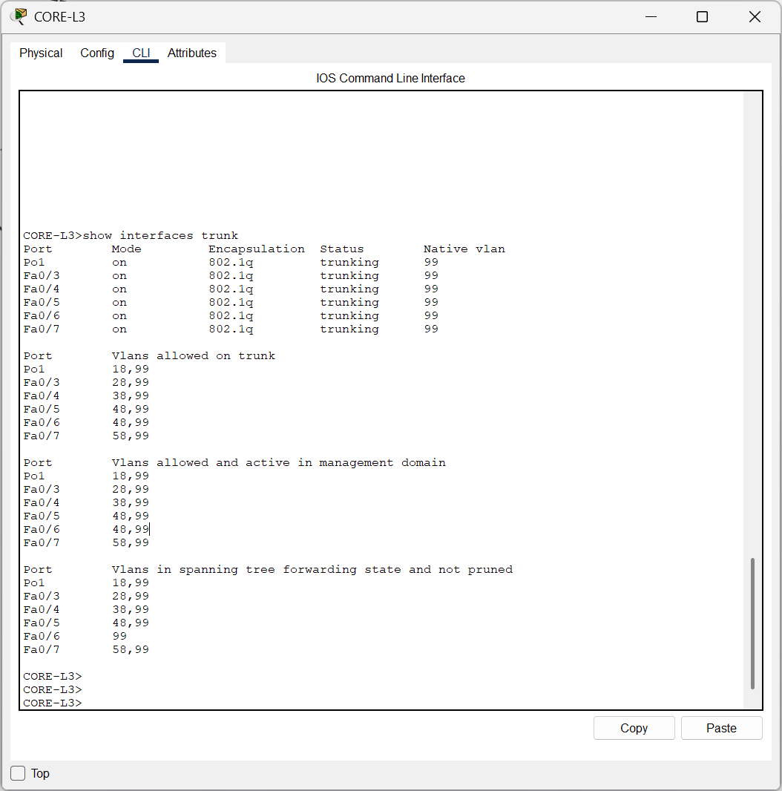

---

# 8. Implementación de VLAN Blackhole

Los puertos que no se utilizan fueron asignados a la VLAN 999.

Posteriormente fueron apagados administrativamente utilizando:

```text
shutdown
```

Esta configuración se aplicó tanto a los switches de las zonas como al `CORE-L3`.

En el CORE quedaron asignados a VLAN 999:

```text
Fa0/8 - Fa0/24
Gig0/1 - Gig0/2
```

Esta medida evita que puertos disponibles puedan ser utilizados accidentalmente o sin autorización.

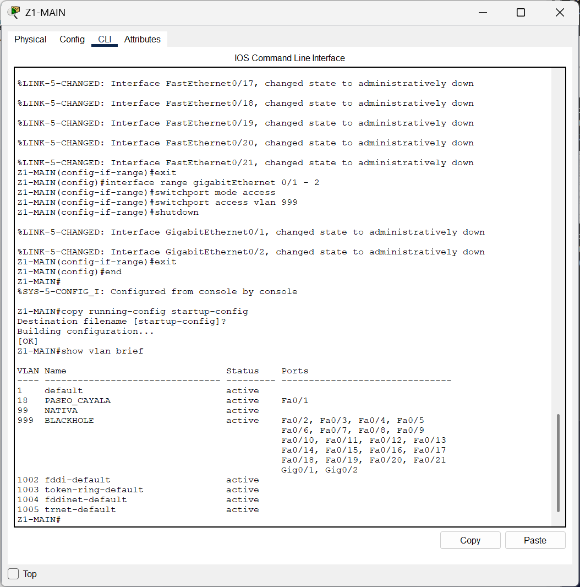

---

# 9. Implementación de Rapid PVST+

Rapid PVST+ fue configurado en los switches mediante:

```text
spanning-tree mode rapid-pvst
```

Se decidió que cada switch principal fuera Root Bridge de la VLAN correspondiente.

Para controlar esta elección se configuró prioridad `4096`.

| Switch | VLAN |
|---|---:|
| Z1-MAIN | 18 |
| Z2-MAIN | 28 |
| Z3-MAIN | 38 |
| Z4-MAIN | 48 |
| Z5-MAIN | 58 |

El objetivo fue mantener un diseño de Spanning Tree predecible, utilizando como Root Bridge al dispositivo principal de cada zona.

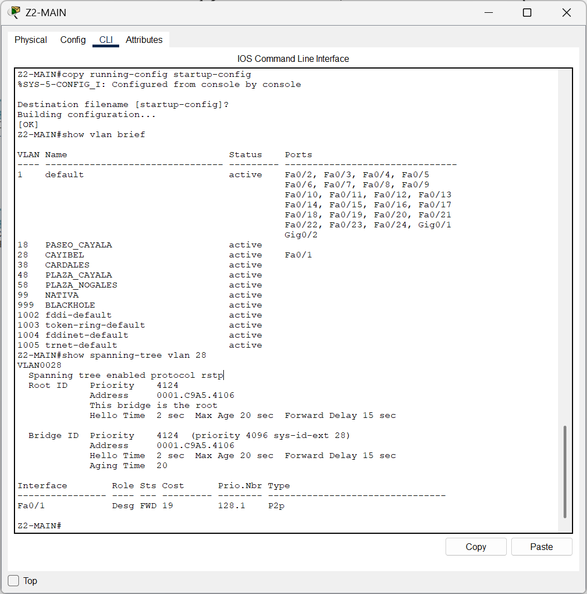

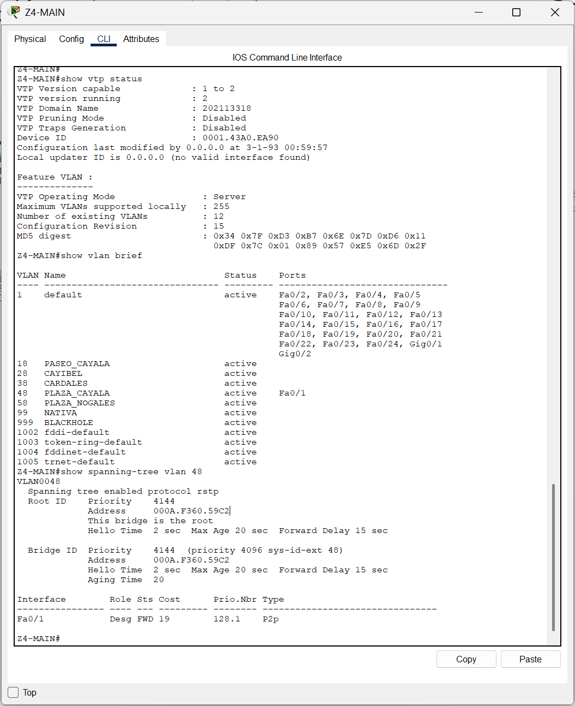

---

# 10. Implementación de redundancia en Zona 4

La Zona 4 fue seleccionada como una zona crítica.

Se implementaron dos caminos físicos desde esta zona hacia el núcleo:

```text
             CORE-L3
             /      \
            /        \
       Z4-MAIN ---- Z4-ACC
```

La existencia de estos enlaces genera un posible bucle de Capa 2.

Rapid PVST+ evita este problema dejando uno de los caminos en estado Forwarding y otro en estado Blocking.

En condiciones normales se obtuvo:

```text
Fa0/5  Root  FWD
Fa0/6  Altn  BLK
```

Esto demuestra que el protocolo seleccionó correctamente un camino principal y uno alternativo.

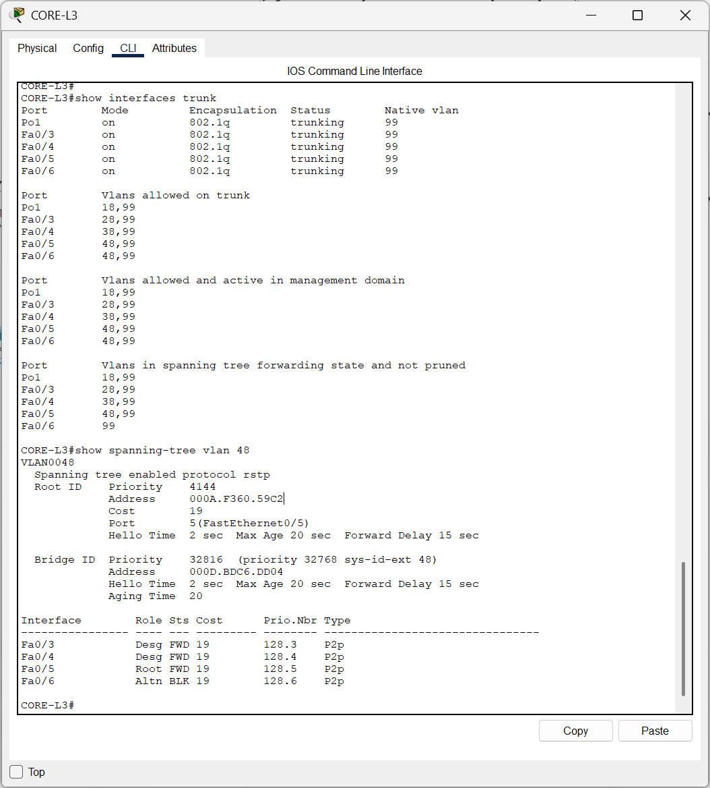

---

# 11. Prueba de failover

Para comprobar la redundancia se apagó temporalmente la interfaz:

```text
CORE-L3 Fa0/5
```

Antes de la falla, `Fa0/5` era el Root Port utilizado para alcanzar el Root Bridge de VLAN 48.

Después de apagar el enlace, Rapid PVST+ realizó una reconvergencia.

El puerto:

```text
Fa0/6
```

pasó a funcionar como nuevo camino hacia el Root Bridge.

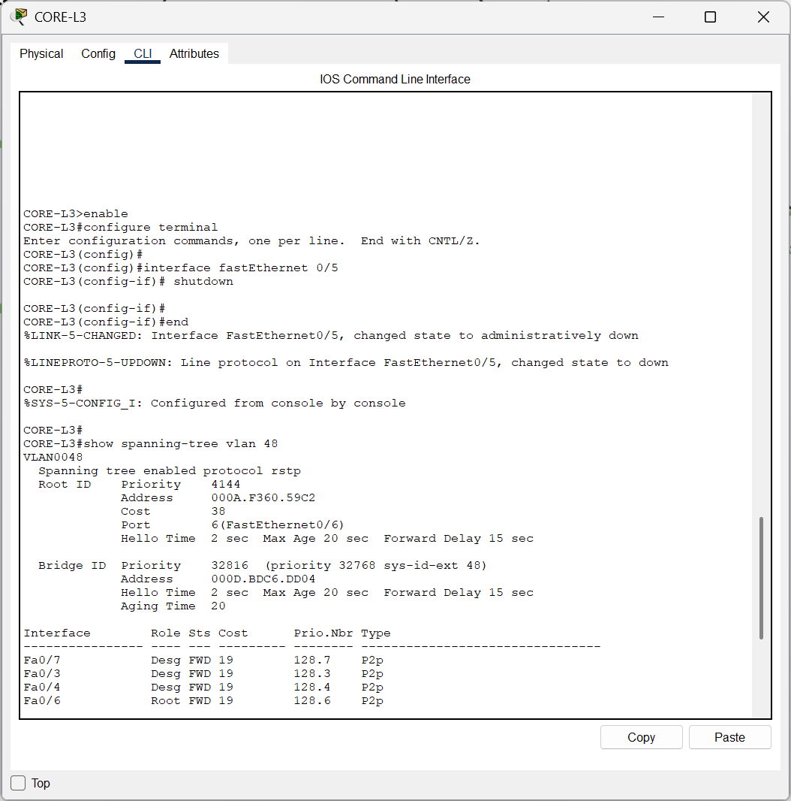

Durante esta condición se ejecutó un ping desde `Z4-PC1` hacia `Z1-PC1`.

```text
Destino: 192.168.18.2
```

La comunicación permaneció activa.

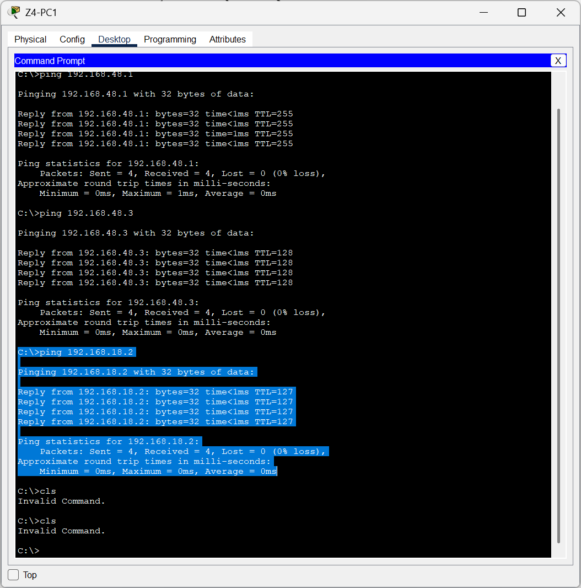

Posteriormente se restauró `Fa0/5`.

Rapid PVST+ regresó automáticamente a la topología normal.

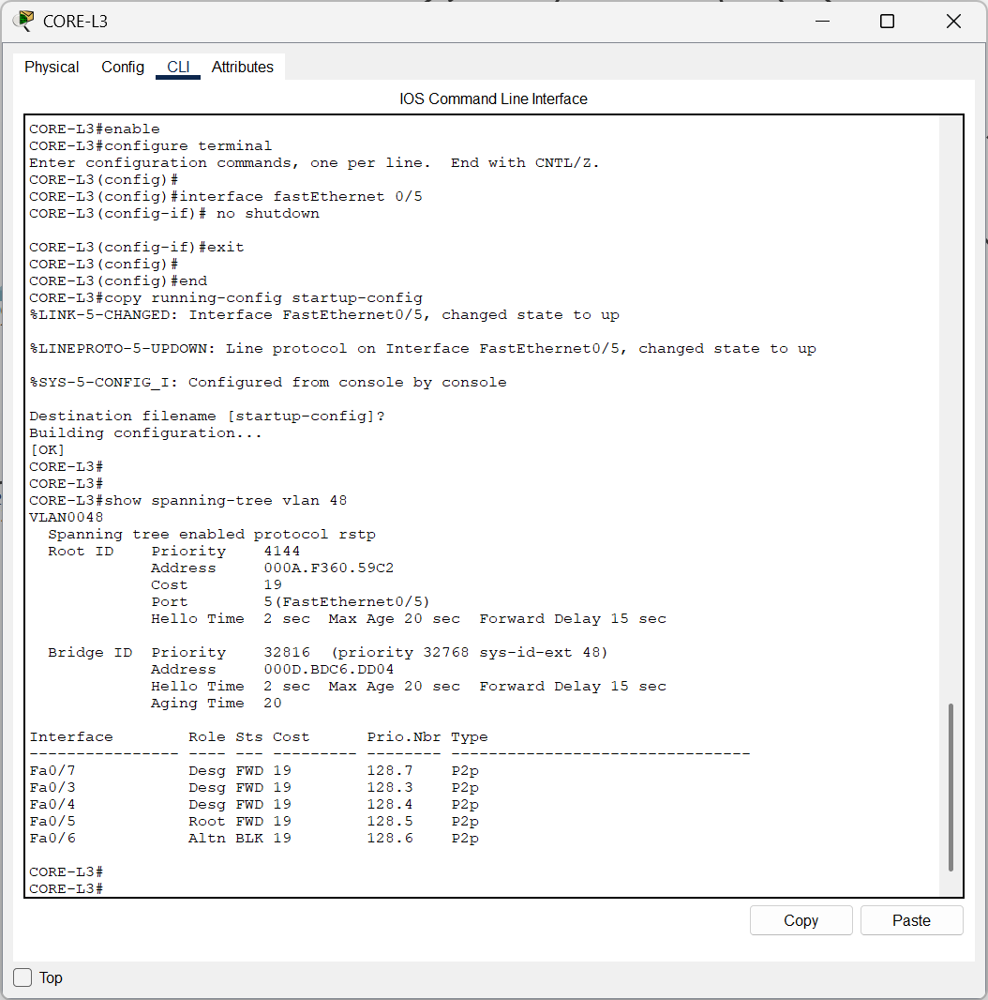

---

# 12. Implementación de EtherChannel

Debido al tráfico esperado en la Zona 1 se decidió utilizar EtherChannel.

Como el último dígito del carné es par, se implementó LACP.

Se utilizaron los enlaces:

```text
CORE-L3 Fa0/1 <-> Z1-MAIN Fa0/23
CORE-L3 Fa0/2 <-> Z1-MAIN Fa0/24
```

Los dos enlaces fueron agrupados en:

```text
Port-Channel1
```

La verificación mediante:

```text
show etherchannel summary
```

mostró:

```text
Po1(SU) LACP Fa0/1(P) Fa0/2(P)
```

Esto confirmó que los dos enlaces físicos se encontraban correctamente incorporados al EtherChannel.

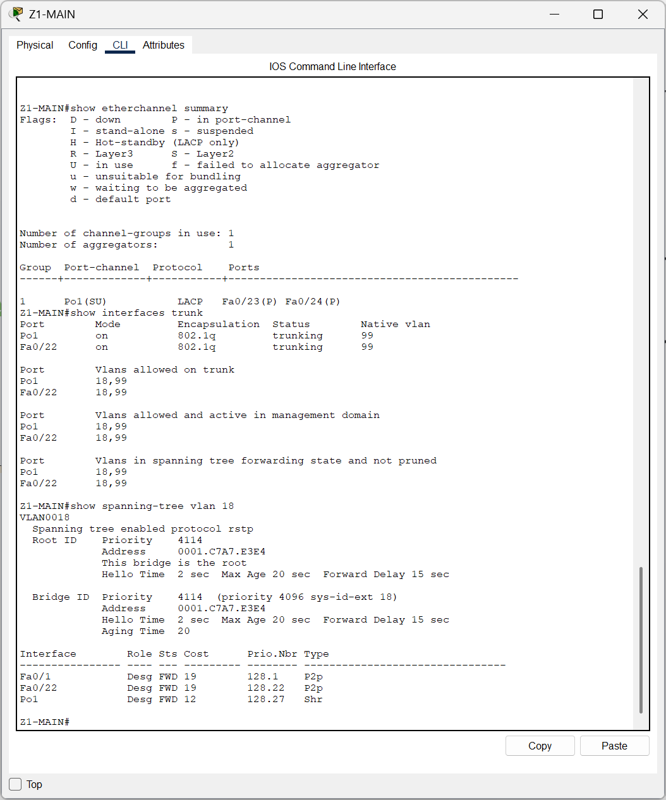

---

# 13. Enrutamiento inter-VLAN

El enrutamiento entre las cinco zonas fue implementado en el switch multicapa `CORE-L3`.

Primero se habilitó:

```text
ip routing
```

Luego se configuraron interfaces SVI:

```text
interface vlan 18
 ip address 192.168.18.1 255.255.255.192

interface vlan 28
 ip address 192.168.28.1 255.255.255.224

interface vlan 38
 ip address 192.168.38.1 255.255.255.240

interface vlan 48
 ip address 192.168.48.1 255.255.255.192

interface vlan 58
 ip address 192.168.58.1 255.255.255.240
```

Las cinco interfaces se verificaron en estado:

```text
up/up
```

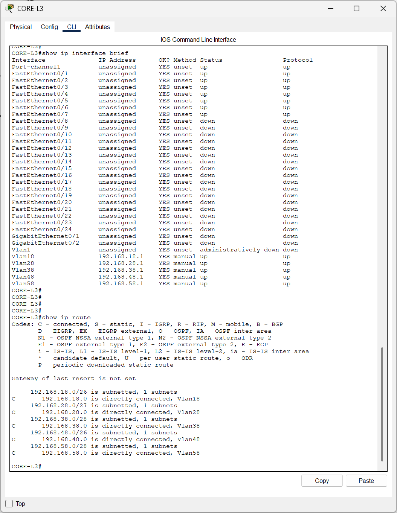

---

# 14. Verificación de la tabla de enrutamiento

Se utilizó:

```text
show ip route
```

El `CORE-L3` mostró:

```text
C 192.168.18.0/26 -> Vlan18
C 192.168.28.0/27 -> Vlan28
C 192.168.38.0/28 -> Vlan38
C 192.168.48.0/26 -> Vlan48
C 192.168.58.0/28 -> Vlan58
```

Las cinco redes aparecen como directamente conectadas.

Esto confirmó que el dispositivo multicapa podía enrutar tráfico entre todas las zonas.

---

# 15. Pruebas de conectividad

Después de completar la configuración se realizaron pruebas de conectividad.

Se validaron tanto comunicaciones dentro de una misma VLAN como comunicaciones entre VLANs diferentes.

| # | Origen | Destino | Resultado |
|---:|---|---|---|
| 1 | Z1-PC1 | Z1-PC2 | Exitoso |
| 2 | Z2-PC1 | Z2-PC2 | Exitoso |
| 3 | Z3-PC1 | Z3-PC2 | Exitoso |
| 4 | Z4-PC1 | Z4-PC2 | Exitoso |
| 5 | Z5-PC1 | Z5-PC2 | Exitoso |
| 6 | Z1-PC1 | Z2-PC1 | Exitoso |
| 7 | Z1-PC1 | Z3-PC1 | Exitoso |
| 8 | Z1-PC1 | Z4-PC1 | Exitoso |
| 9 | Z1-PC1 | Z5-PC1 | Exitoso |
| 10 | Z2-PC1 | Z5-PC1 | Exitoso |

También se verificó la comunicación de los dispositivos con sus respectivos gateways.

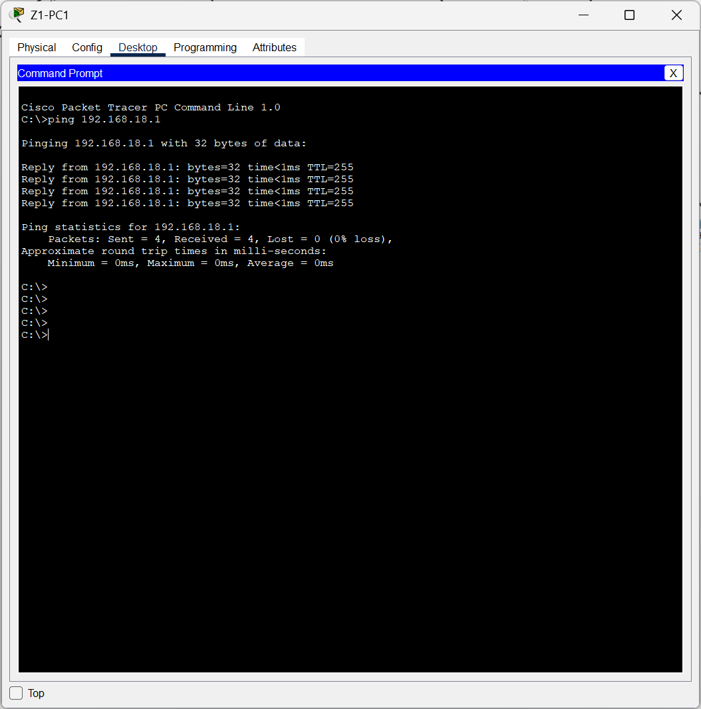

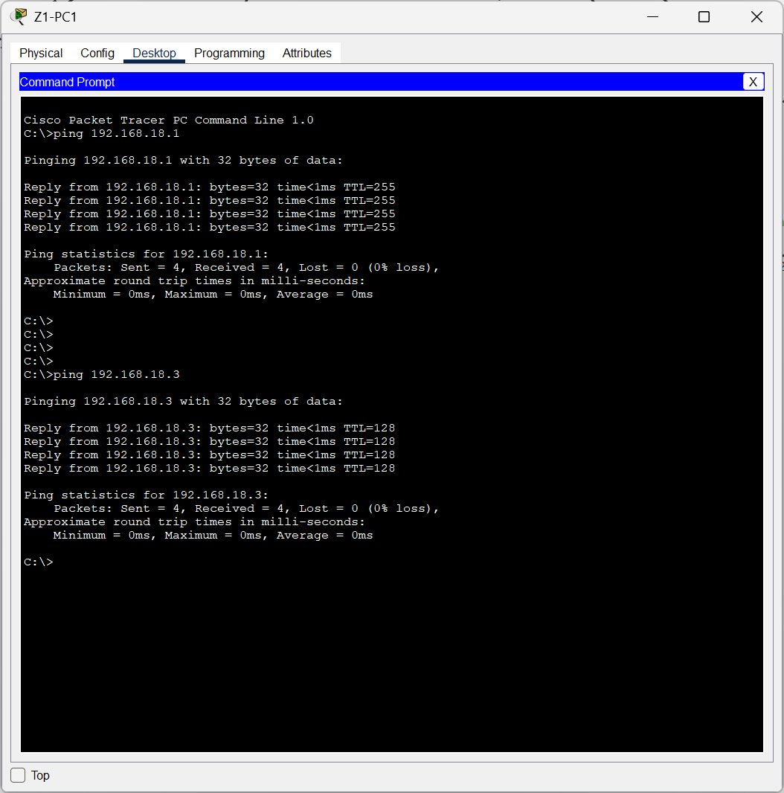

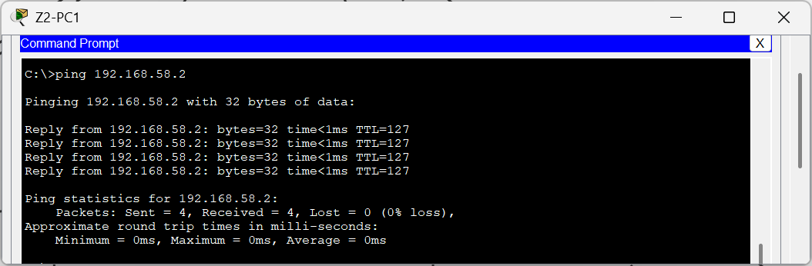

---

# 16. Análisis de ARP e ICMP

Una vez verificada la conectividad se utilizó el modo Simulation de Packet Tracer.

Se realizó comunicación desde:

```text
Z1-PC2
192.168.18.3
```

hacia:

```text
Z2-PC2
192.168.28.3
```

La tabla ARP de `Z1-PC2` se encontraba inicialmente vacía.

Por esta razón el dispositivo tuvo que determinar primero la dirección MAC de su gateway.

La secuencia observada fue:

```text
ARP Request
      ↓
ARP Reply
      ↓
ICMP Echo Request
      ↓
Routing
      ↓
ICMP Echo Reply
```

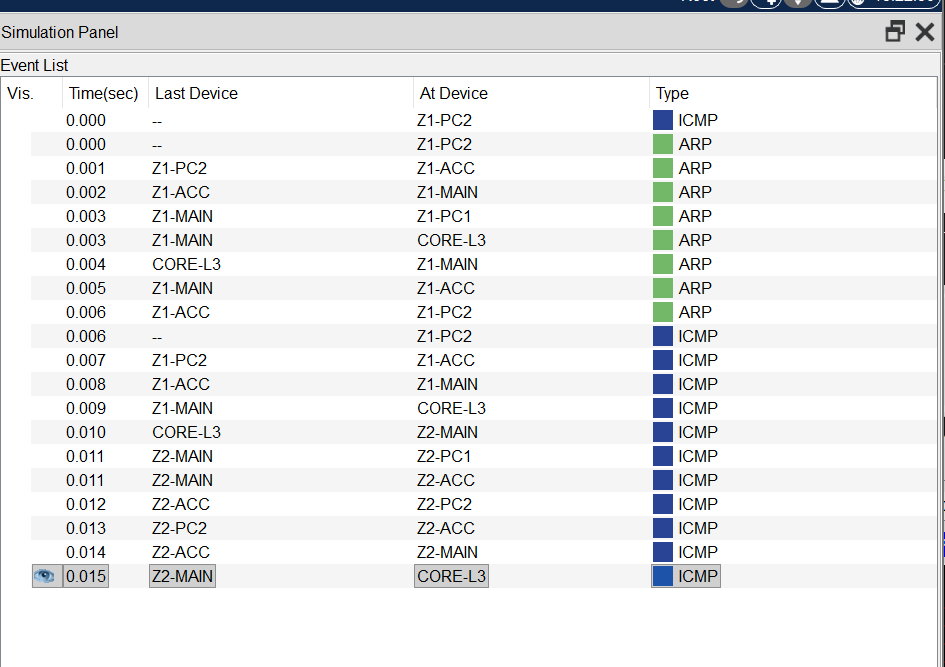

---

# 17. Análisis del ARP Request

El ARP Request utilizó:

```text
Src. IP: 192.168.18.3
Dest. IP: 192.168.18.1
```

Como el dispositivo desconocía la MAC del gateway, la dirección MAC destino fue:

```text
FFFF.FFFF.FFFF
```

Esto confirma que el ARP Request se transmite mediante Broadcast.

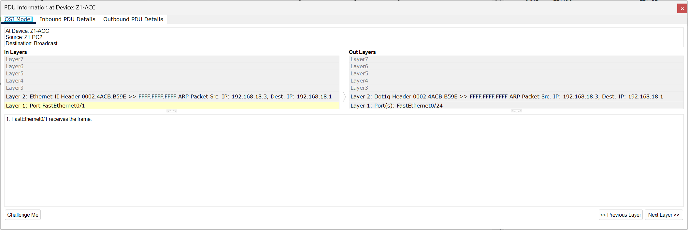

---

# 18. Análisis del ARP Reply

El `CORE-L3` respondió indicando la dirección MAC correspondiente a:

```text
192.168.18.1
```

La respuesta mostró:

```text
Src. IP: 192.168.18.1
Dest. IP: 192.168.18.3
```

La trama fue dirigida directamente hacia la MAC de `Z1-PC2`.

Por lo tanto, el ARP Reply se realizó mediante Unicast.

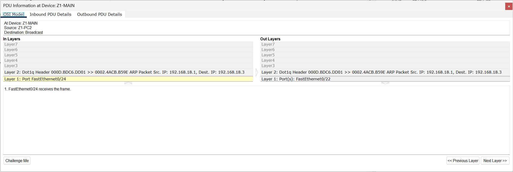

---

# 19. Análisis de IEEE 802.1Q

Durante la simulación también se observó el proceso de etiquetado de VLAN.

Una trama proveniente de `Z1-PC2` ingresó a `Z1-ACC` mediante:

```text
FastEthernet0/1
```

como una trama Ethernet sin etiqueta.

Cuando fue enviada por:

```text
FastEthernet0/24
```

hacia otro switch, Packet Tracer mostró un encabezado:

```text
Dot1Q Header
```

Esto permitió verificar que la etiqueta IEEE 802.1Q es añadida al atravesar un enlace Trunk.

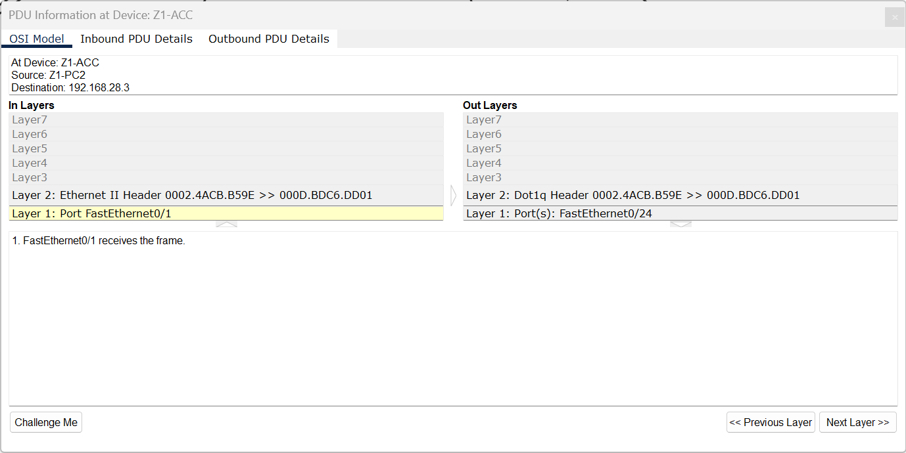

---

# 20. Análisis de routing mediante ICMP

En el `CORE-L3` se observó un paquete:

```text
Src. IP: 192.168.18.3
Dest. IP: 192.168.28.3
ICMP Type: 8
```

El tipo 8 corresponde a un ICMP Echo Request.

El dispositivo consultó su tabla de routing para determinar la interfaz de salida.

Durante este proceso:

- Las direcciones IP origen y destino permanecieron iguales.
- Las direcciones MAC cambiaron para adaptarse al nuevo segmento Ethernet.

Esto demostró la diferencia entre direccionamiento lógico de Capa 3 y direccionamiento físico de Capa 2.

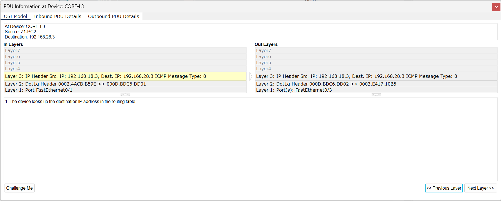

---

# 21. Dominios de colisión

Se realizó el conteo de enlaces físicos de la topología.

| Zona | Dominios de colisión |
|---|---:|
| Zona 1 | 5 |
| Zona 2 | 4 |
| Zona 3 | 4 |
| Zona 4 | 5 |
| Zona 5 | 4 |
| **Total** | **22** |

El resultado final fue:

```text
22 dominios de colisión
```

Aunque los enlaces funcionan en full-duplex y normalmente no se producen colisiones, cada enlace físico representa un segmento Ethernet independiente.

Los dos cables utilizados por EtherChannel se contabilizan físicamente por separado, aunque lógicamente formen un único Port-Channel.

---

# 22. Problemas encontrados y soluciones aplicadas

Durante el desarrollo surgieron diferentes situaciones que requirieron validación y corrección.

## 22.1 Asignación incorrecta de roles en Zona 5

Durante la configuración de Zona 5 se detectó que los comandos correspondientes al switch principal y al switch de acceso habían sido aplicados sobre dispositivos físicos diferentes a los previstos.

Esto provocó que el equipo que debía funcionar como `Z5-MAIN` tuviera temporalmente configuración de cliente VTP.

### Solución

Se revisaron los dispositivos individualmente y se corrigieron:

- Hostnames.
- Rol VTP.
- Interfaces Trunk.
- VLAN de acceso.
- Prioridad de Rapid PVST+.
- Puertos Blackhole.

Después de la corrección:

```text
Z5-MAIN = VTP Server
Z5-ACC  = VTP Client
```

y `Z5-MAIN` quedó configurado como Root Bridge de VLAN 58.

---

## 22.2 Puerto bloqueado en Zona 4

Durante la verificación de los enlaces del CORE se observó que VLAN 48 no aparecía en estado Forwarding por `Fa0/6`.

Inicialmente esto podía interpretarse como una falla del enlace.

### Análisis

Al ejecutar:

```text
show spanning-tree vlan 48
```

se obtuvo:

```text
Fa0/5 Root FWD
Fa0/6 Altn BLK
```

### Solución

Se determinó que no existía una falla.

Rapid PVST+ estaba bloqueando correctamente el enlace alternativo para prevenir un bucle de Capa 2.

Posteriormente se comprobó su correcto funcionamiento mediante la prueba de failover.

---

## 22.3 Verificación de alta disponibilidad

Para comprobar que el enlace bloqueado realmente funcionaba como respaldo se apagó temporalmente:

```text
Fa0/5
```

El enlace `Fa0/6` pasó automáticamente a estado Forwarding.

El ping entre Zona 4 y Zona 1 continuó funcionando.

Después de la prueba se restauró la interfaz y se verificó nuevamente el estado normal de STP.

---

## 22.4 Caché ARP durante las pruebas de simulación

Al iniciar el análisis ARP, `Z1-PC2` ya conocía la dirección MAC de su gateway.

Por esta razón Packet Tracer enviaba directamente los paquetes ICMP y no se observaba un nuevo ARP Request.

Se intentó utilizar:

```text
arp -d 192.168.18.1
```

pero el Command Prompt simplificado de Packet Tracer no soportaba ese comando.

### Solución

Se reinició únicamente `Z1-PC2`.

Después del reinicio se verificó:

```text
arp -a
```

obteniendo:

```text
No ARP Entries Found
```

Al repetir el ping fue posible capturar correctamente:

- ARP Request.
- ARP Reply.
- ICMP Echo Request.
- ICMP Echo Reply.

---

# 23. Resultado final

Después de las configuraciones y correcciones realizadas, la infraestructura quedó operativa.

Se verificó:

- VLANs correctamente configuradas.
- VTP funcionando.
- Trunks con VLANs restringidas.
- VLAN 99 como VLAN nativa.
- VLAN 999 para puertos no utilizados.
- Puertos Blackhole administrativamente apagados.
- Rapid PVST+ funcionando.
- Root Bridges definidos manualmente.
- Redundancia funcional en Zona 4.
- EtherChannel LACP operativo.
- Cinco interfaces SVI en estado `up/up`.
- Enrutamiento entre todas las VLANs.
- Diez pruebas principales de conectividad exitosas.
- Failover exitoso.
- ARP e ICMP analizados mediante Simulation Mode.

Como última etapa de implementación se verificó nuevamente el estado de los enlaces, las interfaces SVI, EtherChannel, Rapid PVST+ y la tabla de enrutamiento. Posteriormente se guardaron las configuraciones mediante `copy running-config startup-config` y se almacenó la versión final del archivo `Practica2.pkt`.

---

# 24. Conclusiones

El desarrollo de la práctica permitió integrar conceptos de Capa 2 y Capa 3 dentro de una misma infraestructura.

La segmentación mediante VLANs permitió organizar las distintas zonas y separar sus dominios de broadcast.

VTP facilitó la administración de VLANs entre switches, mientras que los enlaces Trunk permitieron transportar tráfico de las VLANs necesarias entre dispositivos.

Rapid PVST+ resultó fundamental para implementar redundancia sin generar bucles de Capa 2. La prueba de failover realizada en Zona 4 confirmó que un camino alternativo puede mantener la conectividad ante la pérdida del enlace principal.

EtherChannel mediante LACP permitió agrupar dos enlaces físicos de Zona 1 en un solo enlace lógico, incrementando capacidad y proporcionando redundancia adicional.

Finalmente, el uso del modo Simulation permitió observar de manera detallada el funcionamiento de ARP, ICMP y IEEE 802.1Q, relacionando el comportamiento de los protocolos con la configuración implementada.

---

# 25. Estado final de la práctica

El archivo de simulación final es:

```text
`Practica2.pkt`
```

La simulación contiene la topología completa, las VLANs, VTP, Rapid PVST+, EtherChannel mediante LACP, enlaces Trunk, interfaces SVI y el enrutamiento inter-VLAN.

Al finalizar el desarrollo se verificó que las cinco zonas poseyeran conectividad, que los mecanismos de redundancia funcionaran correctamente y que las configuraciones de los dispositivos fueran almacenadas.
