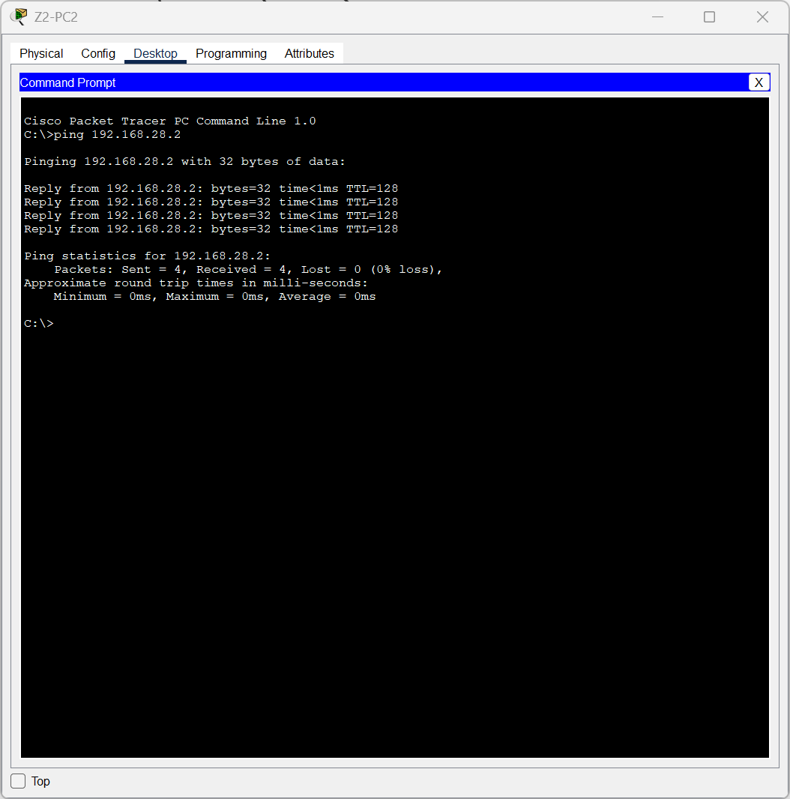
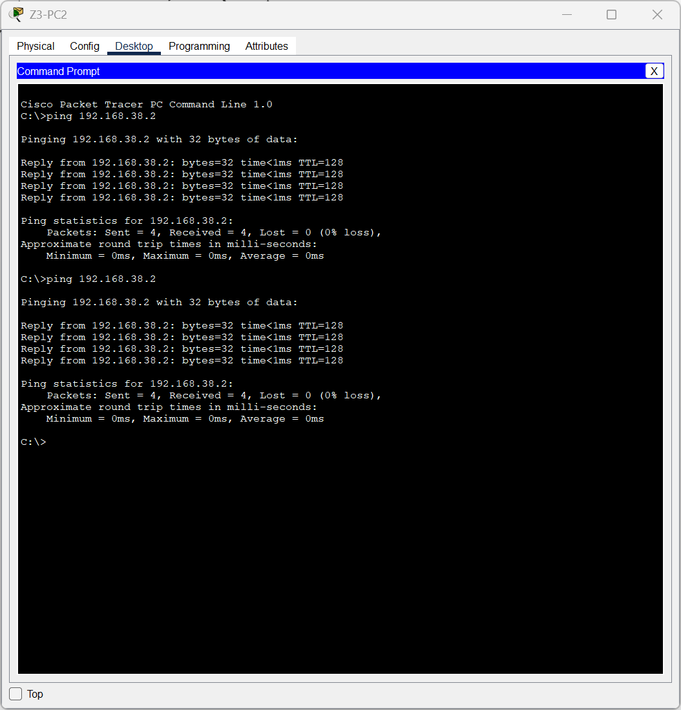
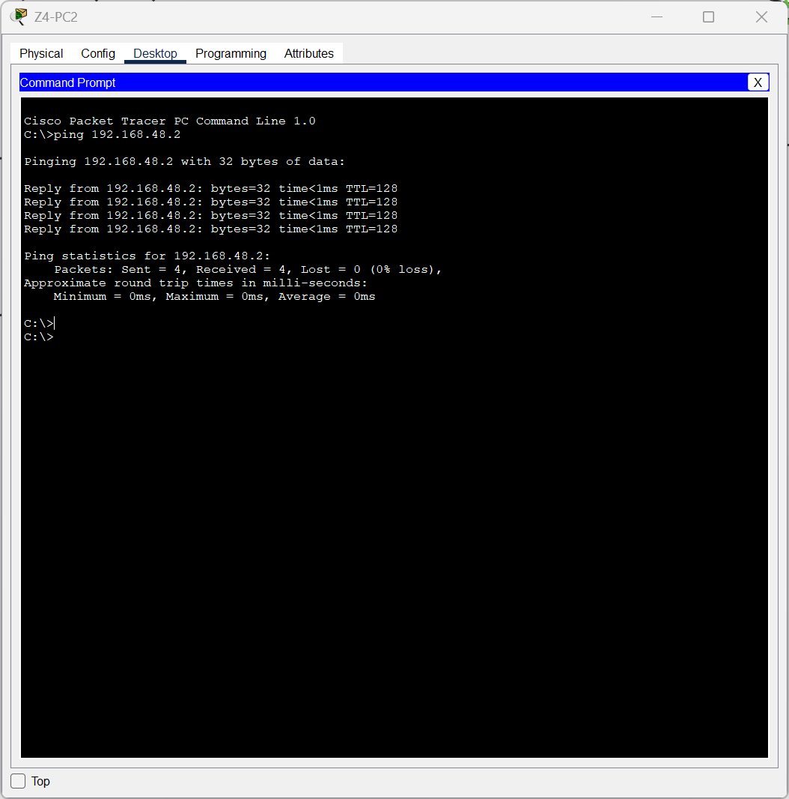

# Manual Técnico — Práctica 2

## Redes de Computadoras 1
### Segundo Semestre 2026

**Universidad de San Carlos de Guatemala**  
**Facultad de Ingeniería**  
**Escuela de Ingeniería en Ciencias y Sistemas**
**Carné:** 202113318 

---

# 1. Introducción

La presente práctica consiste en el diseño e implementación de una red para distintas zonas de Ciudad Cayalá utilizando Cisco Packet Tracer.

La infraestructura fue diseñada con el objetivo de separar lógicamente las áreas mediante VLANs, implementar mecanismos de redundancia y alta disponibilidad, configurar enlaces troncales, aplicar VTP para la administración de VLANs, utilizar Rapid PVST+ para prevenir bucles de Capa 2 e implementar EtherChannel para aumentar capacidad y redundancia.

Adicionalmente, se implementó enrutamiento inter-VLAN mediante un switch multicapa, permitiendo comunicación entre las distintas zonas de la infraestructura.

Durante las pruebas se verificó la conectividad entre hosts, funcionamiento de los gateways, convergencia de Rapid PVST+, funcionamiento de EtherChannel mediante LACP y el comportamiento de los protocolos ARP e ICMP.

---

# 2. Objetivos

## 2.1 Objetivo general

Diseñar e implementar una infraestructura de red segmentada y redundante que permita la comunicación entre cinco zonas de Ciudad Cayalá utilizando tecnologías de Capa 2 y Capa 3.

## 2.2 Objetivos específicos

- Implementar una VLAN independiente para cada zona.
- Configurar VLAN 99 como VLAN nativa.
- Configurar VLAN 999 como VLAN Blackhole para puertos no utilizados.
- Implementar VTP para distribuir la información de VLANs.
- Configurar enlaces Trunk utilizando IEEE 802.1Q.
- Restringir los enlaces Trunk únicamente a las VLAN necesarias.
- Implementar Rapid PVST+.
- Configurar el switch principal de cada zona como Root Bridge.
- Implementar EtherChannel utilizando LACP.
- Implementar redundancia física en una zona crítica.
- Configurar enrutamiento inter-VLAN mediante un switch multicapa.
- Verificar conectividad entre las cinco zonas.
- Analizar el funcionamiento de ARP e ICMP.
- Analizar los dominios de colisión existentes en la topología.

---

# 3. Descripción general de la solución

La red está compuesta por cinco zonas representativas de Ciudad Cayalá:

1. Paseo Cayalá.
2. Cayibel.
3. Cardales de Cayalá.
4. Plaza Cayalá.
5. Plaza Nogales.

Cada zona posee:

- Un switch principal.
- Un switch de acceso.
- Dos dispositivos finales representativos.

El centro de la infraestructura está conformado por un switch multicapa denominado:

```text
CORE-L3
```

Este dispositivo actúa como núcleo de distribución de la red y realiza el enrutamiento entre las VLANs de las distintas zonas.

El `CORE-L3` representa el cuarto de telecomunicaciones o centro de comunicaciones principal de la infraestructura y no corresponde a una sexta zona.

---

# 4. Topología implementada

La infraestructura utiliza una topología híbrida.

La estructura principal corresponde a una topología en estrella, donde las diferentes zonas se conectan hacia el dispositivo central `CORE-L3`.

Adicionalmente, la Zona 4 utiliza una estructura triangular con enlaces redundantes, formando una topología parcialmente mallada.

Esta combinación permite obtener simplicidad en la administración y, al mismo tiempo, tolerancia a fallos en áreas críticas.


---

# 5. Justificación de la topología

La topología híbrida fue seleccionada debido a que las zonas presentan diferentes requerimientos de tráfico, cantidad de usuarios y criticidad.

La topología en estrella facilita la administración de la infraestructura debido a que cada zona posee un enlace claramente definido hacia el núcleo de la red.

La Zona 4 posee redundancia adicional debido a que representa una de las zonas con mayor tráfico y criticidad. Para esta zona se configuraron dos caminos físicos hacia el núcleo.

Rapid PVST+ evita que ambos enlaces sean utilizados simultáneamente de una manera que produzca un bucle de Capa 2.

En condiciones normales, un enlace permanece activo mientras que el segundo funciona como camino alternativo.

En caso de falla del enlace principal, Rapid PVST+ realiza una reconvergencia y habilita automáticamente el enlace alternativo.

La Zona 1 utiliza EtherChannel mediante LACP debido a su alta cantidad de hosts y tráfico esperado.

---

# 6. Dispositivos utilizados

## 6.1 Dispositivo de núcleo

| Dispositivo | Modelo | Función |
|---|---|---|
| CORE-L3 | Cisco 3560 | Switch multicapa, distribución y routing |

## 6.2 Switches por zona

| Zona | Switch principal | Switch de acceso |
|---|---|---|
| Zona 1 | Z1-MAIN | Z1-ACC |
| Zona 2 | Z2-MAIN | Z2-ACC |
| Zona 3 | Z3-MAIN | Z3-ACC |
| Zona 4 | Z4-MAIN | Z4-ACC |
| Zona 5 | Z5-MAIN | Z5-ACC |

Los switches utilizados en las zonas corresponden a equipos Cisco 2960.

## 6.3 Cableado y medios físicos

Para la interconexión de los dispositivos se utilizaron medios Ethernet de cobre, seleccionando el tipo de cable de acuerdo con los dispositivos conectados.

| Tipo de conexión | Medio utilizado | Justificación |
|---|---|---|
| PC ↔ Switch | Copper Straight-Through | Se utiliza para conectar dispositivos de diferente tipo |
| Switch ↔ Switch | Copper Cross-Over | Se utiliza para interconectar dispositivos del mismo tipo |
| CORE-L3 ↔ Switch principal | Copper Cross-Over | Corresponde a una conexión entre dispositivos de conmutación |
| Enlaces EtherChannel | 2 enlaces Copper Cross-Over | Permiten agrupar dos enlaces físicos mediante LACP |
| Enlaces redundantes de Zona 4 | Copper Cross-Over | Permiten disponer de caminos físicos alternativos entre switches |

En los enlaces entre dispositivos finales y switches se utilizó cable directo, mientras que para las conexiones entre switches se utilizó cable cruzado.

En la Zona 1 se utilizaron dos enlaces físicos entre `CORE-L3` y `Z1-MAIN`, los cuales fueron agrupados lógicamente mediante EtherChannel utilizando LACP.

En la Zona 4 se utilizaron enlaces físicos adicionales entre `CORE-L3`, `Z4-MAIN` y `Z4-ACC` para proporcionar redundancia. Rapid PVST+ controla estos enlaces y evita la formación de bucles de Capa 2.

La selección del cableado sigue los principios de cableado estructurado Ethernet definidos por el estándar TIA/EIA-568B.

---

# 7. Identificación de zonas

Para el diseño de la infraestructura se seleccionaron cinco zonas representativas de Ciudad Cayalá. Para cada una se consideró la cantidad de hosts requerida, el tipo de usuarios, el nivel estimado de tráfico y su criticidad dentro de la red.

| Zona | Área seleccionada | Usuarios / función principal | VLAN | Hosts requeridos | Nivel de tráfico | Criticidad |
|---|---|---|---:|---:|---|---|
| Zona 1 | Paseo Cayalá | Comercios, restaurantes, personal administrativo y visitantes | 18 | 60 | Alto | Alta |
| Zona 2 | Cayibel | Restaurantes, comercios, personal de servicio y visitantes | 28 | 28 | Medio-Alto | Media |
| Zona 3 | Cardales de Cayalá | Residentes, personal administrativo y servicios residenciales | 38 | 12 | Medio | Media |
| Zona 4 | Plaza Cayalá | Comercios, oficinas, restaurantes, personal y visitantes | 48 | 50 | Alto | Alta |
| Zona 5 | Plaza Nogales | Comercios, personal administrativo y visitantes | 58 | 7 | Bajo-Medio | Baja/Media |

Las Zonas 1 y 4 fueron consideradas las áreas de mayor tráfico y criticidad debido a la cantidad de hosts requeridos y al tipo de actividad comercial que representan. Por esta razón, en la Zona 1 se implementó EtherChannel para incrementar capacidad y redundancia, mientras que en la Zona 4 se implementaron caminos físicos redundantes controlados mediante Rapid PVST+.

Las zonas restantes presentan requerimientos menores de capacidad, por lo que se utilizaron enlaces simples hacia el núcleo manteniendo igualmente la segmentación mediante VLANs.

---

# 8. VLANs configuradas

Se configuró una VLAN independiente para cada zona.

Adicionalmente se configuraron dos VLANs especiales:

- VLAN 99: VLAN nativa.
- VLAN 999: VLAN Blackhole.

| VLAN | Nombre | Función |
|---:|---|---|
| 18 | PASEO_CAYALA | Zona 1 |
| 28 | CAYIBEL | Zona 2 |
| 38 | CARDALES | Zona 3 |
| 48 | PLAZA_CAYALA | Zona 4 |
| 58 | PLAZA_NOGALES | Zona 5 |
| 99 | NATIVA | VLAN nativa |
| 999 | BLACKHOLE | Puertos no utilizados |


---

# 9. Direccionamiento IP

Para cada zona se creó una subred independiente según la cantidad de hosts requerida.

| Zona | VLAN | Red | Máscara | Prefijo | Gateway |
|---|---:|---|---|---:|---|
| Zona 1 | 18 | 192.168.18.0 | 255.255.255.192 | /26 | 192.168.18.1 |
| Zona 2 | 28 | 192.168.28.0 | 255.255.255.224 | /27 | 192.168.28.1 |
| Zona 3 | 38 | 192.168.38.0 | 255.255.255.240 | /28 | 192.168.38.1 |
| Zona 4 | 48 | 192.168.48.0 | 255.255.255.192 | /26 | 192.168.48.1 |
| Zona 5 | 58 | 192.168.58.0 | 255.255.255.240 | /28 | 192.168.58.1 |

---

# 10. Direcciones asignadas a dispositivos finales

## Zona 1

| Dispositivo | IP | Máscara | Gateway |
|---|---|---|---|
| Z1-PC1 | 192.168.18.2 | 255.255.255.192 | 192.168.18.1 |
| Z1-PC2 | 192.168.18.3 | 255.255.255.192 | 192.168.18.1 |

## Zona 2

| Dispositivo | IP | Máscara | Gateway |
|---|---|---|---|
| Z2-PC1 | 192.168.28.2 | 255.255.255.224 | 192.168.28.1 |
| Z2-PC2 | 192.168.28.3 | 255.255.255.224 | 192.168.28.1 |

## Zona 3

| Dispositivo | IP | Máscara | Gateway |
|---|---|---|---|
| Z3-PC1 | 192.168.38.2 | 255.255.255.240 | 192.168.38.1 |
| Z3-PC2 | 192.168.38.3 | 255.255.255.240 | 192.168.38.1 |

## Zona 4

| Dispositivo | IP | Máscara | Gateway |
|---|---|---|---|
| Z4-PC1 | 192.168.48.2 | 255.255.255.192 | 192.168.48.1 |
| Z4-PC2 | 192.168.48.3 | 255.255.255.192 | 192.168.48.1 |

## Zona 5

| Dispositivo | IP | Máscara | Gateway |
|---|---|---|---|
| Z5-PC1 | 192.168.58.2 | 255.255.255.240 | 192.168.58.1 |
| Z5-PC2 | 192.168.58.3 | 255.255.255.240 | 192.168.58.1 |

---

# 11. VTP

Para administrar la información de VLANs se configuró VTP.

Los switches principales de cada zona funcionan como servidores VTP mientras que los switches secundarios funcionan como clientes.

Se utilizaron los siguientes parámetros:

```text
Dominio VTP: 202113318
Password: Cayala2026
```

## Roles

| Switch | Rol |
|---|---|
| Z1-MAIN | Server |
| Z1-ACC | Client |
| Z2-MAIN | Server |
| Z2-ACC | Client |
| Z3-MAIN | Server |
| Z3-ACC | Client |
| Z4-MAIN | Server |
| Z4-ACC | Client |
| Z5-MAIN | Server |
| Z5-ACC | Client |
| CORE-L3 | Transparent |

El dispositivo `CORE-L3` se configuró en modo VTP Transparent para permitir el paso de anuncios sin depender directamente de la base VTP de una zona.


---

# 12. Enlaces Trunk

Los enlaces entre switches fueron configurados como Trunk utilizando encapsulación IEEE 802.1Q.

La VLAN 99 se configuró como VLAN nativa.

No se permitió el transporte de todas las VLANs indiscriminadamente. Cada enlace únicamente transporta las VLANs necesarias para la zona correspondiente.

## Trunks del CORE-L3

| Puerto | VLANs permitidas | VLAN nativa |
|---|---|---:|
| Port-Channel1 | 18,99 | 99 |
| Fa0/3 | 28,99 | 99 |
| Fa0/4 | 38,99 | 99 |
| Fa0/5 | 48,99 | 99 |
| Fa0/6 | 48,99 | 99 |
| Fa0/7 | 58,99 | 99 |


---

# 13. VLAN Blackhole

La VLAN 999 se utiliza para asignar todos los puertos que no están en uso.

Además, estos puertos fueron administrativamente apagados mediante:

```text
shutdown
```

Esta configuración reduce la posibilidad de conexiones no autorizadas en puertos disponibles.

En el CORE-L3 se asignaron a VLAN 999:

```text
Fa0/8 - Fa0/24
Gig0/1 - Gig0/2
```

Los puertos no utilizados de los switches de acceso y principales también fueron asignados a VLAN 999.


---

# 14. Rapid PVST+

Se configuró Rapid PVST+ en los switches de la infraestructura.

```text
spanning-tree mode rapid-pvst
```

Cada switch principal fue configurado como Root Bridge de la VLAN correspondiente.

| Switch | VLAN | Prioridad configurada | Prioridad mostrada |
|---|---:|---:|---:|
| Z1-MAIN | 18 | 4096 | 4114 |
| Z2-MAIN | 28 | 4096 | 4124 |
| Z3-MAIN | 38 | 4096 | 4134 |
| Z4-MAIN | 48 | 4096 | 4144 |
| Z5-MAIN | 58 | 4096 | 4154 |

La diferencia entre la prioridad configurada y la mostrada se debe al System ID Extension utilizado por STP, donde se incorpora el número de VLAN.

La selección de cada switch `Zx-MAIN` como Root Bridge de su VLAN se realizó porque estos dispositivos cumplen la función de switch principal o de distribución dentro de cada zona.

Al colocar el Root Bridge en el switch principal se obtiene una topología más predecible, ya que las decisiones de Spanning Tree se orientan hacia el dispositivo que concentra la comunicación de la zona con el núcleo de la red.

Esta decisión también facilita la administración y la resolución de problemas, debido a que el camino lógico principal de cada VLAN queda asociado al switch que posee el rol central dentro de su respectiva zona.

Por esta razón se configuró una prioridad de `4096` para la VLAN correspondiente en cada switch principal, reduciendo su prioridad respecto a los demás switches y asegurando que sea seleccionado como Root Bridge.

| VLAN | Root Bridge seleccionado | Justificación |
|---:|---|---|
| 18 | Z1-MAIN | Switch principal de Zona 1 y punto de concentración hacia el CORE |
| 28 | Z2-MAIN | Switch principal de Zona 2 y punto de concentración hacia el CORE |
| 38 | Z3-MAIN | Switch principal de Zona 3 y punto de concentración hacia el CORE |
| 48 | Z4-MAIN | Switch principal de Zona 4 y referencia para la topología redundante |
| 58 | Z5-MAIN | Switch principal de Zona 5 y punto de concentración hacia el CORE |


---

# 15. Redundancia de Zona 4

La Zona 4 fue diseñada con dos caminos físicos hacia el CORE.

```text
              CORE-L3
              /                  /               Z4-MAIN ---- Z4-ACC
```

Rapid PVST+ determina cuál de los enlaces debe reenviar tráfico y cuál debe mantenerse bloqueado para prevenir un bucle.

En condiciones normales:

```text
Fa0/5 = Root Port / Forwarding
Fa0/6 = Alternate / Blocking
```

El resultado observado fue:

```text
Fa0/5    Root    FWD
Fa0/6    Altn    BLK
```


---

# 16. Prueba de failover de Rapid PVST+

Para verificar la tolerancia a fallos se apagó temporalmente el enlace principal `CORE-L3 Fa0/5`.

Rapid PVST+ realizó una reconvergencia y el enlace alternativo `Fa0/6` pasó a ser el nuevo Root Port.

Durante la falla, se realizó un ping desde `Z4-PC1` hacia `192.168.18.2`, correspondiente a `Z1-PC1`.

El resultado fue exitoso, demostrando que la infraestructura mantiene conectividad incluso cuando falla el enlace principal de Zona 4.


Posteriormente se restauró `Fa0/5`, regresando la topología a su estado normal.


---

# 17. EtherChannel

La Zona 1 fue seleccionada para implementar EtherChannel debido a su cantidad de hosts y nivel de tráfico esperado.

Debido a que el último dígito del carnet utilizado es par, se implementó **LACP**.

Los enlaces utilizados son:

```text
CORE-L3 Fa0/1 <-> Z1-MAIN Fa0/23
CORE-L3 Fa0/2 <-> Z1-MAIN Fa0/24
```

Ambos enlaces se agruparon en `Port-Channel1`.

La verificación mediante `show etherchannel summary` mostró:

```text
Po1(SU) LACP Fa0/1(P) Fa0/2(P)
```

Donde:

- `S`: Port-Channel de Capa 2.
- `U`: Port-Channel en uso.
- `P`: puerto correctamente agregado al canal.


---

# 18. Enrutamiento inter-VLAN

El switch multicapa `CORE-L3` realiza el enrutamiento entre las cinco VLANs.

Se habilitó:

```text
ip routing
```

Posteriormente se configuraron las interfaces virtuales SVI:

```text
Vlan18  192.168.18.1
Vlan28  192.168.28.1
Vlan38  192.168.38.1
Vlan48  192.168.48.1
Vlan58  192.168.58.1
```

Todas las interfaces se verificaron en estado `up/up`.


---

# 19. Tabla de enrutamiento

El comando `show ip route` mostró las cinco redes como directamente conectadas:

```text
C 192.168.18.0/26 -> Vlan18
C 192.168.28.0/27 -> Vlan28
C 192.168.38.0/28 -> Vlan38
C 192.168.48.0/26 -> Vlan48
C 192.168.58.0/28 -> Vlan58
```

No fue necesario configurar una ruta por defecto debido a que la práctica representa únicamente las redes internas de la infraestructura.

---

# 20. Pruebas de conectividad

Se realizaron pruebas de conectividad dentro de cada VLAN y entre VLANs diferentes para comprobar el correcto funcionamiento de la infraestructura.

## 20.1 Pruebas intra-VLAN

Para verificar la conectividad dentro de cada zona se realizaron diez pruebas intra-VLAN utilizando los dos dispositivos finales representativos de cada VLAN.

| # | Origen | Destino | VLAN | Resultado |
|---:|---|---|---:|---|
| 1 | Z1-PC1 | Z1-PC2 | 18 | Exitoso |
| 2 | Z1-PC2 | Z1-PC1 | 18 | Exitoso |
| 3 | Z2-PC1 | Z2-PC2 | 28 | Exitoso |
| 4 | Z2-PC2 | Z2-PC1 | 28 | Exitoso |
| 5 | Z3-PC1 | Z3-PC2 | 38 | Exitoso |
| 6 | Z3-PC2 | Z3-PC1 | 38 | Exitoso |
| 7 | Z4-PC1 | Z4-PC2 | 48 | Exitoso |
| 8 | Z4-PC2 | Z4-PC1 | 48 | Exitoso |
| 9 | Z5-PC1 | Z5-PC2 | 58 | Exitoso |
| 10 | Z5-PC2 | Z5-PC1 | 58 | Exitoso |

Todas las pruebas intra-VLAN fueron satisfactorias.

En cada prueba se obtuvo:

```text
Packets: Sent = 4, Received = 4, Lost = 0 (0% loss)
```

El valor `TTL=128` observado confirma que la comunicación se realizó directamente entre dispositivos pertenecientes a la misma VLAN, sin atravesar el dispositivo de Capa 3.

También fueron probados los gateways correspondientes de cada zona.


### Evidencias de conectividad intra-VLAN









## 20.2 Pruebas inter-VLAN

Además de las pruebas dentro de cada VLAN, se realizaron pruebas entre dispositivos pertenecientes a redes diferentes para verificar el funcionamiento del enrutamiento inter-VLAN realizado por `CORE-L3`.

| # | Origen | Destino | VLAN origen | VLAN destino | Resultado |
|---:|---|---|---:|---:|---|
| 1 | Z1-PC1 | Z2-PC1 | 18 | 28 | Exitoso |
| 2 | Z1-PC1 | Z3-PC1 | 18 | 38 | Exitoso |
| 3 | Z1-PC1 | Z4-PC1 | 18 | 48 | Exitoso |
| 4 | Z1-PC1 | Z5-PC1 | 18 | 58 | Exitoso |
| 5 | Z2-PC1 | Z5-PC1 | 28 | 58 | Exitoso |

Todas las pruebas inter-VLAN fueron exitosas.

El tráfico entre VLANs diferentes es procesado por las interfaces SVI configuradas en `CORE-L3`, utilizando la función:

```text
ip routing
```

---

# 21. Análisis de dominios de colisión

En una red conmutada, cada enlace Ethernet físico representa un segmento independiente.

Aunque los enlaces utilizados trabajan en full-duplex y normalmente no existen colisiones reales, académicamente cada enlace físico puede considerarse un dominio de colisión independiente.

| Zona | Enlaces físicos | Dominios |
|---|---:|---:|
| Zona 1 | 5 | 5 |
| Zona 2 | 4 | 4 |
| Zona 3 | 4 | 4 |
| Zona 4 | 5 | 5 |
| Zona 5 | 4 | 4 |
| **Total** | **22** | **22** |

Por lo tanto:

```text
Total de dominios de colisión = 22
```

En Zona 1 existen dos enlaces físicos entre `CORE-L3` y `Z1-MAIN`. Aunque LACP los agrupa lógicamente en un único Port-Channel, físicamente continúan siendo dos enlaces independientes.

En Zona 4 existe un enlace adicional debido a la redundancia implementada entre el CORE, el switch principal y el switch de acceso.

---

# 22. Análisis de ARP

Para observar el funcionamiento de ARP se utilizó el modo Simulation de Packet Tracer.

Inicialmente se vació la caché ARP de `Z1-PC2` reiniciando el dispositivo.

Posteriormente se verificó:

```text
arp -a
```

obteniendo:

```text
No ARP Entries Found
```

Se realizó un ping desde `Z1-PC2` (`192.168.18.3`) hacia `Z2-PC2` (`192.168.28.3`).

Como el destino pertenece a una red diferente, `Z1-PC2` necesitaba conocer primero la dirección MAC de su gateway `192.168.18.1`.

---

# 23. ARP Request

El ARP Request mostró:

```text
Src. IP: 192.168.18.3
Dest. IP: 192.168.18.1
```

A nivel de Capa 2 se observó:

```text
0002.4ACB.B59E >> FFFF.FFFF.FFFF
```

La dirección `FFFF.FFFF.FFFF` representa una dirección MAC de Broadcast.

Por lo tanto, el host está preguntando a todos los dispositivos dentro de su dominio de broadcast quién posee `192.168.18.1`.


---

# 24. ARP Reply

El dispositivo `CORE-L3`, propietario de la dirección `192.168.18.1`, respondió hacia `Z1-PC2`.

Se observó:

```text
Src. IP: 192.168.18.1
Dest. IP: 192.168.18.3
```

y:

```text
000D.BDC6.DD01 >> 0002.4ACB.B59E
```

En este caso la respuesta es **Unicast**, debido a que el gateway ya conoce la dirección MAC del dispositivo que realizó la solicitud.


---

# 25. Análisis de IEEE 802.1Q

Durante la simulación del tráfico ARP e ICMP también fue posible observar el funcionamiento de los enlaces Access y Trunk.

En `Z1-ACC`, una trama recibida desde una PC ingresó por `FastEthernet0/1` como una trama Ethernet sin etiqueta.

Al salir por `FastEthernet0/24` hacia otro switch, Packet Tracer mostró un `Dot1Q Header`.

Esto demuestra que el switch agrega la etiqueta IEEE 802.1Q cuando la trama debe atravesar un enlace Trunk.


---

# 26. Análisis ICMP y enrutamiento

Se realizó una prueba ICMP desde `192.168.18.3` hacia `192.168.28.3`.

En `CORE-L3` se observó:

```text
Src. IP: 192.168.18.3
Dest. IP: 192.168.28.3
ICMP Type: 8
```

El tipo 8 corresponde a un `ICMP Echo Request`.

Packet Tracer indicó que el dispositivo realizó una consulta de la dirección destino en su tabla de enrutamiento.

Las direcciones IP permanecieron iguales, pero las direcciones MAC cambiaron cuando el paquete fue reenviado hacia el siguiente segmento.

Esto demuestra una característica fundamental del routing:

- Las direcciones IP identifican los extremos de la comunicación.
- Las direcciones MAC son utilizadas para la entrega local en cada segmento de Capa 2.


---

# 27. Secuencia ARP e ICMP

La simulación permitió observar que ARP ocurre antes de ICMP cuando el dispositivo no posee la dirección MAC del gateway.

```text
ARP Request
      |
      v
Resolución de dirección MAC
      |
      v
ARP Reply
      |
      v
Dirección MAC almacenada
      |
      v
ICMP Echo Request
      |
      v
Routing
      |
      v
ICMP Echo Reply
```

Esta prueba permitió verificar el funcionamiento conjunto de protocolos de Capa 2 y Capa 3.

---

# 28. Alta disponibilidad

La infraestructura implementa dos mecanismos principales de alta disponibilidad.

## 28.1 EtherChannel

Zona 1 utiliza dos enlaces físicos agrupados mediante LACP.

Beneficios:

- Mayor capacidad.
- Distribución de tráfico.
- Redundancia.
- Un enlace físico puede fallar sin perder completamente el Port-Channel.

## 28.2 Rapid PVST+

Zona 4 posee dos caminos hacia el núcleo.

Rapid PVST+ selecciona un camino activo y mantiene otro como alternativo.

En caso de fallo del camino principal, el enlace alternativo pasa automáticamente a estado Forwarding.

---

# 29. Seguridad básica de Capa 2

Como parte de la configuración se aplicaron las siguientes medidas:

- VLAN 999 para puertos no utilizados.
- Puertos no utilizados en estado `shutdown`.
- VLAN 99 como VLAN nativa.
- Restricción de VLANs permitidas en enlaces Trunk.
- Puertos de usuario configurados explícitamente como Access.
- Uso de PortFast únicamente en puertos conectados a dispositivos finales.

Estas configuraciones ayudan a reducir errores de conexión y tráfico innecesario.

---

# 30. Resultados obtenidos

La infraestructura implementada permitió comprobar satisfactoriamente:

- Comunicación dentro de cada VLAN.
- Comunicación entre las cinco zonas.
- Correcto funcionamiento de los gateways.
- Correcto enrutamiento inter-VLAN.
- Propagación adecuada de VLANs mediante VTP.
- Funcionamiento de enlaces Trunk.
- VLAN nativa 99.
- Protección de puertos no utilizados mediante VLAN 999.
- Funcionamiento de Rapid PVST+.
- Selección de Root Bridge.
- Redundancia de Zona 4.
- Reconvergencia ante falla del enlace principal.
- Funcionamiento de EtherChannel mediante LACP.
- Resolución ARP mediante Broadcast y Unicast.
- Funcionamiento de ICMP.
- Etiquetado IEEE 802.1Q.
- Cambio de direcciones MAC durante el routing.
- Mantenimiento de las direcciones IP origen y destino durante la comunicación extremo a extremo.

---

# 31. Conclusiones

La implementación permitió comprobar la importancia de la segmentación mediante VLANs en redes empresariales, ya que permite separar los dominios de broadcast y organizar los dispositivos según su función.

El uso de enlaces Trunk permitió transportar múltiples VLANs entre dispositivos manteniendo la separación lógica mediante IEEE 802.1Q.

Rapid PVST+ permitió implementar enlaces físicos redundantes sin producir bucles de Capa 2. Las pruebas de failover demostraron que el protocolo puede reconverger ante una falla y mantener la conectividad de los usuarios.

EtherChannel permitió combinar dos enlaces físicos en un único enlace lógico, proporcionando mayor capacidad y redundancia.

El uso de un switch multicapa permitió realizar enrutamiento entre las cinco VLANs de manera centralizada mediante interfaces SVI.

Finalmente, el análisis mediante el modo Simulation de Cisco Packet Tracer permitió observar detalladamente la interacción entre ARP, Ethernet, IEEE 802.1Q, IP e ICMP, facilitando la comprensión del proceso completo de comunicación entre dispositivos pertenecientes a redes diferentes.

---

# 32. Recomendaciones

- Mantener una nomenclatura consistente para dispositivos, VLANs y enlaces.
- Restringir las VLANs permitidas en los enlaces Trunk.
- Utilizar una VLAN Blackhole para puertos no utilizados.
- Deshabilitar administrativamente los puertos sin uso.
- Implementar redundancia únicamente cuando exista una justificación técnica.
- Verificar siempre el estado de STP antes de considerar un enlace bloqueado como una falla.
- Realizar pruebas de failover para comprobar realmente la alta disponibilidad.
- Verificar las tablas de enrutamiento antes de diagnosticar problemas de conectividad.
- Guardar la configuración de los dispositivos después de cada modificación importante.
- Utilizar el modo Simulation de Packet Tracer para analizar protocolos cuando exista alguna duda sobre el recorrido de los paquetes.

---

# 33. Archivo de simulación

El archivo final de Cisco Packet Tracer correspondiente a la práctica es:

```text
Practica2.pkt
```

Este archivo contiene la topología, configuración de los dispositivos, direccionamiento, VLANs, VTP, Rapid PVST+, EtherChannel y enrutamiento inter-VLAN implementados durante la práctica.
